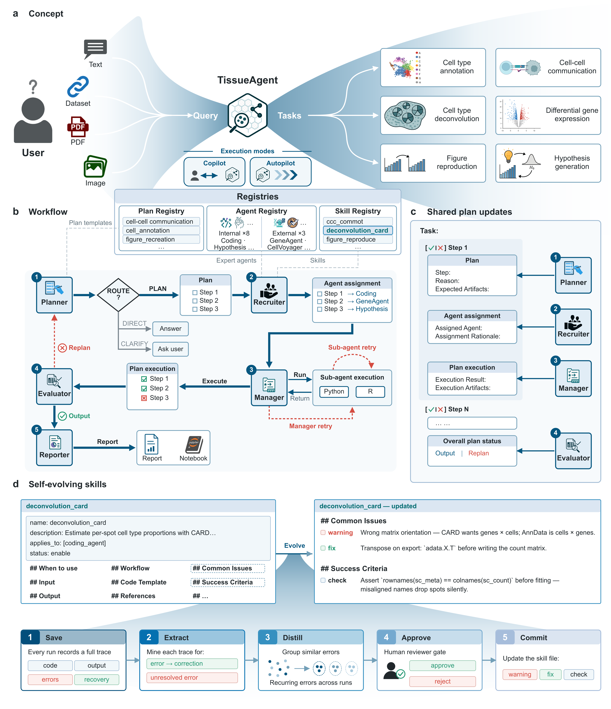

# TissueAgent: A Role-Based Multi-Agent Framework for Reproducible Spatial Transcriptomics Workflows

TissueAgent turns natural-language spatial transcriptomics requests and inputs such as datasets, PDFs, and images into runnable analyses, figures, and reports. A shared plan coordinates planning, recruitment, execution, evaluation, and reporting, with saved step status and artifact links.

Supported workflows include figure reproduction, cell-type annotation, cell–cell communication, differential expression, and deconvolution. Specialized external agents can be recruited for gene interpretation, genomics questions, and single-cell analysis.



**Getting started:** [Quick start](#quick-start) · [Installation](#installation) · [Credentials and models](#credentials-and-models) · [Run TissueAgent](#run-tissueagent) · [External agents](#external-agents) · [Examples and outputs](#examples-and-outputs) · [Advanced setup and troubleshooting](#advanced-setup-and-troubleshooting) · [Architecture](#architecture)

Installation and interface are separate choices. Install the Python environment once, then use any of these interfaces:

| Interface | Best suited to | Additional setup | Interaction |
| --- | --- | --- | --- |
| Web UI | Interactive analysis and project management | Build the frontend with Node.js/npm | Autopilot or Copilot |
| Notebook | Running and adapting manuscript examples | Use the installed Python environment as the Jupyter kernel | Autopilot |
| CLI | Terminal use and scripted runs | None beyond the Python environment | Autopilot |

The shell examples below target macOS/Linux. Run commands from the repository root unless a block explicitly changes directory.

## Quick start

This path installs with **uv** and launches the Web UI. Have [Git](https://git-scm.com/), [uv](https://docs.astral.sh/uv/getting-started/installation/), and [Node.js 22.12+ with npm](https://nodejs.org/) available. For a Python-only workflow, follow [Installation](#installation) and then [Notebook](#notebook) or [CLI](#cli).

```bash
git clone --recurse-submodules https://github.com/ma-compbio/TissueAgent.git
cd TissueAgent
uv sync --frozen --python 3.12
source .venv/bin/activate

# Default model credentials; alternatively enter the key in the Web UI.
export OPENAI_API_KEY="your-openai-api-key"

npm --prefix src/frontend ci
npm --prefix src/frontend run build
PYTHONPATH=src python -m uvicorn server.main:app --host 127.0.0.1 --port 8000
```

Open **http://127.0.0.1:8000**. Add a dataset through the Library, attach any project-specific reference files, and enter an analysis request. The [demo guide](demo/README.md) describes the included example inputs.

The cloned submodules provide the external-agent source code. To enable CellVoyager as well, complete its [separate environment setup](#external-agents).

## Installation

<a id="repository-set-up"></a>

### Clone or update an existing checkout

If you followed the quick start, continue to [Credentials and models](#credentials-and-models). Otherwise clone the repository as shown above, or initialize submodules in an existing checkout:

```bash
git submodule sync --recursive
git submodule update --init --recursive
```

### Choose one Python environment

The repository's Python version is **3.12**. Choose one of the following methods; each supports the Web UI, notebooks, and CLI.

**uv — recommended for the checked-in dependency versions**

```bash
uv sync --frozen --python 3.12
source .venv/bin/activate
```

This installs the project and dependencies from `uv.lock`. Reactivate `.venv` in each new Python terminal, or use `uv run --frozen` before a command.

**Conda + pip**

Install [Miniconda](https://docs.anaconda.com/miniconda/) if Conda is not already available.

```bash
conda env create -f environment.yml
conda activate tissueagent
python -m pip install -e .
```

`environment.yml` supplies Python 3.12, Node.js 22, and pip. The editable pip install installs TissueAgent and resolves its Python dependencies from `pyproject.toml`. Use `conda activate tissueagent` in subsequent terminals.

**Nix + uv**

Install [Nix](https://nixos.org/download/) with flake support enabled before using this option.

```bash
nix develop
uv sync --frozen --python 3.12
source .venv/bin/activate
```

The [Nix flake](flake.nix) supplies the development toolchain, including Python, uv, Node.js/npm, and an R environment. Enter `nix develop` again for each new terminal, then activate `.venv` for Python commands.

### Verify the Python installation

With your chosen environment active:

```bash
python --version
tissueagent --help
git submodule status
```

The help command needs no API key and makes no model calls. The submodule listing should contain GeneAgent, GeneGPT, and CellVoyager at their pinned commits; a leading `-` indicates an uninitialized submodule and `+` indicates a checkout that differs from the pinned commit.

Node.js/npm are needed to build or develop the Web UI. Notebook and CLI use do not require the frontend build. Task-specific tools such as Tesseract and R are covered under [Advanced setup](#advanced-setup-and-troubleshooting).

## Credentials and models

<a id="llm-credentials"></a>

The default model is `gpt-5.5`. Export the key for the provider you intend to use **before starting the server, Jupyter, or CLI**:

```bash
export OPENAI_API_KEY="your-openai-api-key"
# Optional, when using these providers:
export ANTHROPIC_API_KEY="your-anthropic-api-key"
export OPENROUTER_API_KEY="your-openrouter-api-key"
```

| Provider | Environment variable | Example registered model IDs |
| --- | --- | --- |
| [OpenAI](https://platform.openai.com/api-keys) | `OPENAI_API_KEY` | `gpt-5.5`, `gpt-5.4`, `gpt-5.1` |
| [Anthropic](https://console.anthropic.com/settings/keys) | `ANTHROPIC_API_KEY` | `claude-opus-4-7`, `claude-sonnet-4-6` |
| [OpenRouter](https://openrouter.ai/keys) | `OPENROUTER_API_KEY` | `openrouter/gpt-5.1`, `openrouter/claude-sonnet-4-6` |

In the Web UI, **sidebar → API keys** also accepts provider keys. These keys are held in server memory and override the corresponding environment values for that server. Separate notebook and CLI processes need their own environment keys. CellVoyager's subprocess also needs exported keys; see [External agents](#external-agents).

Choose the model with `--model <id>` in the CLI, the demo notebook's `MODEL` setting where provided, or the UI's **Orchestration agents** and **Expert agents** dropdowns. The CLI flag selects both roles. In the UI, changing orchestration updates the expert model by default; **sync** re-links them after an independent change. Changes apply to the next request. The current model catalog, including self-hosted options, is defined in [`src/models.py`](src/models.py).

## Run TissueAgent

Activate the environment you installed above and return to the repository root in each new terminal.

### Web UI

For normal use, build the frontend once, then serve it with the backend:

```bash
npm --prefix src/frontend ci
npm --prefix src/frontend run build
PYTHONPATH=src python -m uvicorn server.main:app --host 127.0.0.1 --port 8000
```

Open **http://127.0.0.1:8000**. On later launches, only the last command is needed; rebuild after frontend source changes. The backend serves the UI when `src/frontend/dist/` exists.

For frontend development with hot reload, install frontend dependencies as above and run these in two terminals:

```bash
# Terminal 1: backend, with the Python environment active
PYTHONPATH=src python -m uvicorn server.main:app --reload --reload-dir src --host 127.0.0.1 --port 8000
```

```bash
# Terminal 2: frontend, from the repository root
npm --prefix src/frontend run dev -- --host 127.0.0.1
```

Open **http://127.0.0.1:5173**. The development frontend proxies API and WebSocket traffic to port 8000.

<a id="execution-modes"></a>

The UI offers two interaction modes:

- **Autopilot** (default): runs the full workflow without approval pauses.
- **Copilot**: pauses after planning and recruitment. Approve, edit the plan or agent assignments, send feedback, or cancel from the plan panel.

The mode persists with the session. Finish or cancel a run before changing modes. Notebook and CLI runs always use Autopilot.

### Notebook

From the activated Python environment:

```bash
python -m notebook
```

Open a notebook under `demo/` and run it from top to bottom. Make sure its kernel uses the environment where TissueAgent was installed. If the environment is not available in Jupyter's kernel menu, register it once:

```bash
python -m ipykernel install --user --name tissueagent --display-name "TissueAgent"
```

Select **TissueAgent** as the notebook kernel. In a notebook cell, `import sys; print(sys.executable)` shows which interpreter is running. Credentials must be available to the Jupyter process before launching a fresh agent run.

See [Examples and outputs](#examples-and-outputs) and the [demo guide](demo/README.md) for input files, saved reports, and cache reuse.

### CLI

The installed `tissueagent` command runs the full workflow on one prompt. It streams the agent trace to stderr and writes the answer to stdout.

```bash
# Stage your dataset and save a structured response.
tissueagent --json --dataset ./my_sample.h5ad \
  "Summarize the cell types in library/datasets/my_sample.h5ad" > result.json

# Attach a project-specific reference file.
tissueagent --attach ./markers.csv "Interpret the genes in uploads/markers.csv"

# Read a prompt from a text file.
tissueagent --quiet - < prompt.txt
```

With uv, `uv run --frozen tissueagent ...` runs the same entry point without manually activating `.venv`. With dependencies installed, the module entry point is also available from the repository root:

```bash
PYTHONPATH=src python -m cli --help
```

| Flag | Purpose |
| --- | --- |
| `--model <id>` | Select the model for both orchestration and expert roles |
| `--dataset <path>` | Copy a reference dataset to `library/datasets/`; repeat for multiple inputs |
| `--attach <path>` | Copy a file to the project's `uploads/`; repeat for multiple attachments |
| `--json` | Return structured output including answer, project ID, artifacts, and staged paths |
| `--quiet`, `-q` | Suppress the streaming trace |
| `--docker`, `--no-docker` | Select Docker or a local gateway for R skill steps |
| `-` | Read the prompt from stdin |

Use `tissueagent --help` for all flags. CLI runs are saved as projects and appear in the Web UI when both processes use the same [state root](#state-and-output-locations).

## External agents

| Agent | Purpose | Environment and credentials |
| --- | --- | --- |
| [GeneAgent](https://github.com/ncbi-nlp/GeneAgent) | Interpret a gene set with evidence from biological databases | TissueAgent environment; `OPENAI_API_KEY`; pinned `gpt-5.1` |
| [GeneGPT](https://github.com/ncbi/GeneGPT) | Answer factual genomics questions through NCBI E-utilities and BLAST | TissueAgent environment; `OPENAI_API_KEY`; pinned `gpt-4o`; NCBI internet access |
| [CellVoyager](https://github.com/zou-group/CellVoyager) | Analyze an AnnData dataset and produce a notebook and hypotheses | Separate `cellvoyager` Conda environment; exported `ANTHROPIC_API_KEY` or `OPENAI_API_KEY` |

All three upstream sources are pinned submodules. `git clone --recurse-submodules` or `git submodule update --init --recursive` fetches them. GeneAgent and GeneGPT use the main environment's dependencies and require no separate pip installation; their adapters handle upstream API compatibility.

To enable CellVoyager, have Conda available on the application's `PATH` and create its environment once, even if you installed TissueAgent with uv or Nix:

```bash
conda env create -n cellvoyager \
  -f src/agents/agent_registry/cellvoyager_agent/upstream/environment.yml
```

The lowercase name `cellvoyager` is required by the adapter. If that environment already exists, update it with `conda env update -n cellvoyager -f src/agents/agent_registry/cellvoyager_agent/upstream/environment.yml`. Keep the TissueAgent environment active when launching TissueAgent; the adapter invokes CellVoyager through `conda run`.

Verify its import from the upstream directory:

```bash
(
  cd src/agents/agent_registry/cellvoyager_agent/upstream
  conda run -n cellvoyager python -c "import cellvoyager; print('CellVoyager OK')"
)
```

CellVoyager uses `claude-sonnet-4-6` when an Anthropic environment key is available. With only an OpenAI environment key, the adapter selects `gpt-4o`. Its tool's `model_name` argument can override that choice. GeneAgent and GeneGPT retain their pinned models independently of TissueAgent's main model selection.

See the [GeneAgent adapter](src/agents/agent_registry/gene_agent/README.md), [GeneGPT adapter](src/agents/agent_registry/genegpt_agent/README.md), and [integration guide](INTEGRATING.md) for implementation details and adding an external agent.

## Examples and outputs

<a id="demo"></a>

The [demo guide](demo/README.md) documents the notebooks, required inputs, and retained reports. The Lohoff examples include all five panels, **2a–2e**; the heart example demonstrates spot deconvolution. Notebook outputs already contain executed figures and reports where available.

- Fig. **2b, 2d, and 2e** retain their runs under `cached/{TASK}/`, including reports, figures, tables, logs, state, and executed notebook copies. Pre-rerun notebook backups are under `cached/notebook_backups/`.
- Fig. **2a and 2c** retain runs under `demo/outputs/`. Each notebook's `OUTPUT_DIR` gives its exact location.
- Both output directories are Git-ignored. Lohoff notebooks reuse a completed run only when its model, prompt, and input hashes match; choose a fresh output directory for a new run. Running without matching cached results makes model calls and needs credentials.

The Fig. 2d and 2e reports document approximations required by missing original graph/polygon inputs. See the reports for scientific limitations and differences from the published panels. Model-generated analyses can vary between runs.

**Web UI demonstration:**

https://github.com/user-attachments/assets/ef381418-cf5c-431b-9052-f931c922d2c8

## Advanced setup and troubleshooting

### Task-specific dependencies

| Capability | Additional requirement |
| --- | --- |
| Figure reproduction with reference-label OCR | Tesseract executable on `PATH`; `pytesseract` is included in the Python dependencies. Check with `tesseract --version`. |
| Local R skill steps | R with the IRkernel Jupyter kernel and the packages needed by the task |
| Docker R skill steps | Docker installed and running; see [R kernel setup](DOCKER.md) |
| CellVoyager | Its separate Conda environment and exported provider credentials, as described above |

<a id="coding-sandbox"></a>

The coding agent runs Python and shell commands locally. For steps assigned the `r-execution` skill, the R gateway runs locally by default; **Docker for R steps** in Web Settings or `--docker` in the CLI selects the container. These settings affect the R gateway. See [DOCKER.md](DOCKER.md) for details.

### State and output locations

By default, runtime state is stored under the repository root:

| Content | Default location |
| --- | --- |
| Shared reference datasets and files | `workspace/library/datasets/`, `workspace/library/files/` |
| Active project's inputs and generated artifacts | `workspace/project/uploads/`, `workspace/project/outputs/` |
| Parked projects | `projects/<project_id>/` |
| In-flight plans and logs | `plan_scratch/`, `logs/` |
| Retained demo runs | Notebook-specific `cached/` or `demo/outputs/` paths |

`library/` is read-only to agents. Switching projects parks the old project outside the agent-visible workspace. External-agent tools return artifact paths: GeneAgent and GeneGPT write under active-project outputs; CellVoyager also retains its upstream run under `workspace/cellvoyager_agent/` and publishes hypothesis artifacts to the active project.

Set `TISSUEAGENT_STATE_ROOT` **before starting a process** to relocate its workspace, projects, plans, and logs. The Lohoff notebooks set an isolated state root for each generated run. To run independent processes concurrently, give them separate state roots and separate `TISSUEAGENT_GATEWAY_PORT` values if they use R gateways; choose separate Web UI server ports as well.

### Common setup issues

| Symptom | Check or fix |
| --- | --- |
| `tissueagent` or a Python package is missing | Activate the installed environment; check `python -c "import sys; print(sys.executable)"`. With uv, use `uv run --frozen tissueagent --help`. |
| A notebook cannot import installed packages | Select the correct kernel; register it with the command in [Notebook](#notebook), then restart the kernel. |
| The backend runs but the Web UI is absent | Build `src/frontend/dist/` using the [Web UI](#web-ui) commands, or start the development frontend and open port 5173. |
| Frontend installation rejects the Node version | Check `node --version`; use Node.js 22.12 or later. |
| Provider authentication fails | Export the relevant key before launching that process, or set it in the UI for that server. Keys entered in the UI do not configure separate notebook/CLI processes. |
| An external-agent upstream directory is empty | Run `git submodule update --init --recursive` from the repository root. |
| CellVoyager cannot import | Check `conda` is on `PATH`, the environment is named `cellvoyager`, and the import verification above passes. |
| A Lohoff notebook rejects an existing output directory | Use the matching completed run or choose a new `OUTPUT_DIR`; preserve the previous run for comparison. |

TissueAgent is a local, single-user application. The documented web commands bind to `127.0.0.1`; the API and WebSocket have no sign-in, so keep the server local. Uploads are limited to 8 GiB per file by default; set `TISSUEAGENT_MAX_UPLOAD_BYTES` before launching the server to change that limit.

## Architecture

The entry points are `src/server/main.py` (Web UI backend) and `src/cli.py` (CLI, also used by the Lohoff notebooks). They invoke the shared workflow in `src/graph/` and the agents registered in `src/agents/`.

| Directory | Purpose |
| --- | --- |
| `src/agents/`, `src/graph/` | Agents, tools, and workflow orchestration |
| `src/server/`, `src/frontend/` | FastAPI backend and React/Vite Web UI |
| `knowledge/` | Plans, skills, scripts, and reference documentation |
| `demo/` | Example notebooks and inputs |
| `docs/`, `tests/` | Documentation and regression checks |
| `site/` | Separate informational website |
| `docker/` | Optional R kernel image |

See [Repository structure](docs/REPOSITORY_STRUCTURE.md) for the source and runtime layout, and [INTEGRATING.md](INTEGRATING.md) for external-agent integration.

## Data Availability

All datasets referenced in the manuscript are publicly available:
- Developing human heart MERFISH dataset (Farah et al., 2024): [https://cells.ucsc.edu/?ds=hoc](https://cells.ucsc.edu/?ds=hoc)
- 10x Visium human heart dataset (Kanemaru et al., 2023): [https://www.heartcellatlas.org/](https://www.heartcellatlas.org/)
- Single-cell reference dataset for cell type deconvolution: [CellxGene collection b52eb423](https://cellxgene.cziscience.com/collections/b52eb423-5d0d-4645-b217-e1c6d38b2e72)
- 10x Visium Alzheimer's disease spatial transcriptomics dataset (Miyoshi et al., 2024): GEO accession [GSE233208](https://www.ncbi.nlm.nih.gov/geo/query/acc.cgi?acc=GSE233208)
- Spatial mouse atlas (Lohoff et al., 2022): [https://crukci.shinyapps.io/SpatialMouseAtlas/](https://crukci.shinyapps.io/SpatialMouseAtlas/)
- Mouse CNS STARmap PLUS atlas (Shi et al., 2023): [Zenodo record 8327576](https://zenodo.org/records/8327576)
- Ovarian cancer spatial atlas (Vázquez-García et al., 2024): [Zenodo record 12613839](https://zenodo.org/records/12613839)
- Spatiotemporal transcriptomics dataset (Chen et al., 2022): CNGBdb accession [STDS0000058](https://db.cngb.org/search/project/STDS0000058/)

### License

[MIT License](LICENSE)
